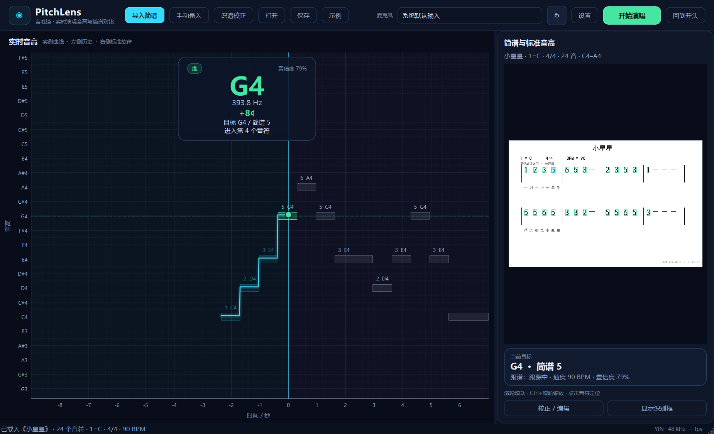
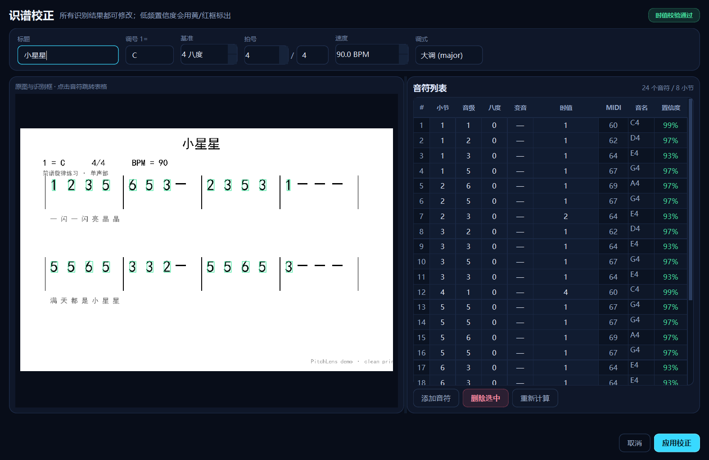

# PitchLens 音准镜

实时唱歌音高监测 + 简谱图片标准音高对比。Windows 本地运行，音频与图片不上传网络。



识别结果可逐音校正，原图框与表格双向联动：



## 已实现

- **实时音高曲线**：麦克风采集 → 环形缓冲 → YIN 检测 → 60 fps 曲线；当前时刻固定在横向中央，左侧历史、右侧未来标准旋律。
- **中央读数**：当前音名、频率、音分偏差、置信度，以及目标音和简谱音级。
- **标准音高带**：每个目标音符以半音位置的水平带显示，当前目标高亮，并显示 `5 G4` 形式的标签。
- **简谱图片识别**：调号 `1=C`、拍号 `4/4`、BPM、音符数字、八度点、升降号、减时线、附点、延音线、小节线；保留每个音符在原图中的位置。
- **弧线止血**：检测音符上方的连音线/延音线弧线，并从“增时线 dash”候选中排除，避免弧线顶部被误判成多一拍；目前只提示人工确认，不自动合并时值。
- **可视化校正**：原图叠加识别框（包含数字、八度点、降号/升号、减时线的联合框），表格修改音级/八度/变音/时值/小节，低频置信度黄/红标出，实时乐理校验。
- **在线跟谱**：按谱面时值推进休止，支持自由速度、重复音、跳音、换气、丢失重定位和点击音符手动定位。
- **暂停回看**：暂停后可左右拖动查看本次演唱的全部音高曲线。继续演唱保留此前曲线，并回到实时视图。加载另一份乐谱或重置位置时清空曲线。
- **项目保存**：`.pitchproj` 单文件 zip，包含图片、乐谱和识别参数。
- **离线运行**：不依赖网络；识别在独立线程中执行，不阻塞音频。

## 快速开始

环境：Windows 10/11 + Python 3.11–3.15（推荐 3.12/3.13），麦克风。

```bat
run.bat
```

首次运行会创建 `.venv` 并安装依赖。也可以手动：

```powershell
python -m venv .venv
.\.venv\Scripts\python.exe -m pip install -r requirements.txt
.\.venv\Scripts\python.exe -m pitchlens
```

直接看示例：

```bat
run_demo.bat
```

或打开 `examples\小星星.pitchproj`。

## 使用流程

1. 选择麦克风（顶栏），建议佩戴耳机，避免伴奏被麦克风拾取。
2. 点击 **导入简谱** 选择 JPG/PNG，等待自动识别；或点击 **手动录入** 粘贴简谱文本。
3. 识别有低置信度/时值警告时，点击 **识谱校正**，在原图上核对并修改。
4. 点击 **开始演唱**。中央显示当前音高，右侧显示未来标准音高带；唱准后曲线变绿/黄/红。
5. 点击简谱上的任意音符可以手动把跟谱位置定位到那里。
6. 点击 **暂停** 后可以左右拖动回看历史；点击“回到当前”回到实时位置，点击“开始演唱”从当前音符继续。
7. 点击 **保存** 保存为 `.pitchproj`，下次直接打开。

### 手动简谱文本格式

```text
1=C 4/4 90
| 1 2 3 5 | 6 5 3 - | 2 3 5 3 | 1 - - - |
```

- `1'` 高八度，`1,` 低八度
- `1_` 八分音符，`1__` 十六分音符
- `1.` 附点，`-` 将本小节上一音符延长一拍。跨小节的延长线会在预览中提示，并按新小节的一拍休止处理。
- `0` 休止，`#4` / `b7` 升降音

## 简谱识别的边界

识别器针对**清晰的印刷体/电子版、单旋律、常规排版**，采用：

1. 灰度/光照校正、Otsu/自适应二值化、投影法去倾斜；
2. 水平/垂直线分离，保留小节线和节奏线；
3. 弧线检测：把连音线/延音线的弧形从水平线候选中剔除，避免误判为增时线；
4. 连通域提取 + 字符合并 + 多字体模板分类；
5. 空间关系组装八度点、升降号、减时线、附点和延音线；
6. 小节时值校验和低置信度标记。

以下情况需要人工校正或手动录入：手写谱、多声部、复杂反复/跳房子、严重透视/模糊照片、非标准字体、歌词与音符粘连。识别结果不会被静默当作正确结果：有疑问的音符会标黄/标红，并提示打开校正。

> 当前对弧线只做“检测 + 从增时线中排除 + 提示”，**不会自动把延音线合并时值**。原因是弧线端点容易落到歌词/相邻音符上，自动合并一旦判错会静默改变节奏；等真实测试集基线稳定后再做语义合并。

## 技术结构

```text
麦克风
  ↓ sounddevice 回调（只采集/打时间戳/写环形缓冲）
环形缓冲 + 独立分析线程
  ↓ YIN（内置）/ CREPE（可选）
PitchFrame（audio_time / frequency / midi / confidence / voiced / onset）
  ↓                         ↘
实时曲线（pyqtgraph）       在线跟谱（受限 HMM + 速度估计）
                                 ↑
                         结构化 Score（音符 + 原图 bbox）
                                 ↑
                     简谱图片识别 / 手动录入 / 校正
```

### 目录

```text
pitchlens/
  core/
    audio.py        麦克风、环形缓冲、分析线程
    pitch.py        YIN、CREPE 适配器、显示平滑
    music.py        十二平均律、音名、简谱→MIDI
    score.py        NoteEvent / Score / 时值与校验
    jianpu_text.py  简谱文本解析
    recognition.py  图像预处理、符号识别、结构组装
    follower.py     在线跟谱、速度估计、失焦恢复
    project.py      .pitchproj 保存/读取
    settings.py     设置数据
  ui/
    main_window.py  主窗口、音频生命周期、识别线程
    pitch_timeline.py  滚动音高/标准旋律视图
    score_view.py   原图 + 识别框 + 点击定位
    editor.py       识谱校正对话框
    text_input.py   手动简谱录入
    settings_dialog.py
    theme.py
  demo.py           示例简谱渲染
examples/           示例图片和 .pitchproj
tests/              单元测试
```

## CREPE（可选）

默认使用内置 YIN：无需模型、启动快、离线可用。`pitchlens/core/pitch.py` 保留了 `PitchDetector` 接口和 CREPE 适配器：

- 安装 `requirements-crepe.txt`（Python ≤3.14 有 onnxruntime wheel）；
- 准备 CREPE ONNX 模型，在设置中填写模型路径；
- 或者安装 `torch` + `torchcrepe`，适配器会自动尝试。
- 如果不可用，程序会明确回退到 YIN，不会崩溃。

## 测试

```powershell
.\.venv\Scripts\python.exe -m unittest discover -s tests -v
```

覆盖：音名/简谱映射、YIN 合成音、简谱文本、示例图片识别、弧线检测、跟谱（固定/自由速度/重复音/起唱一致性）、项目读写、环形缓冲。

### 真实简谱基线

用户提供的印刷/截图简谱放在 `tests/fixtures/jianpu/`。有同名 `.expected.txt` 的图片会计算音级、时值、小节通过率；没有标注的图片只输出结构统计，不会把识别器自己的输出当作 ground truth。

```powershell
$env:PITCHLENS_REAL_OCR = "1"
.\.venv\Scripts\python.exe -m unittest tests.test_recognition_real -v
```

报告写入 `tests/fixtures/jianpu/baseline_report.json`。公开仓库只包含自渲染的 `demo_jianpu` 示例；真实歌曲简谱图片不随仓库分发。你可以将自己有权使用的测试图片放入该目录，再启用真实图片基线：

- demo（有标注）：24 音符 / 8 小节 / 0 警告，音级、时值、小节通过率均为 100%。
- 真实图片需要自行补充 `.expected.txt` 才能计算音级、时值和小节准确率；没有标注时只输出结构统计，不能据此宣称识别率。

## 打包

```powershell
.\build.ps1
```

生成 `dist\PitchLens\PitchLens.exe`（one-folder，含示例和资源）。仓库内的 `installer.iss` 可用 Inno Setup 6 编译为安装包；先把 `installer.iss` 中的 `dist\PitchLens` 作为输入目录。

## 隐私

- 麦克风音频只在本地内存中处理，不写入磁盘、不上传。
- 简谱图片与项目文件只在本地读写。
- 保存的项目文件包含图片，分享前请注意。

## 已知限制

- 自动识谱不是 100%：复杂排版、照片、手写谱请用校正/手动录入。
- 弧线检测是保守的“止血版”：可能漏检与数字粘连的弧线，也可能把印刷弧线当成弧线而排除其顶部；出现“检测到 N 条连音线/延音线”时请人工确认时值。
- 真实简谱测试集目前只有 demo 有 ground truth；19 张真实图片尚未逐音标注，不能据此宣称识别率。
- 自动跟谱在连续同音、自由速度、漏唱时可能歧义；始终可以用“点击音符”手动定位。
- 当前版本没有伴奏播放、录音回放、节拍器和评分；后续可在现有 `PitchFrame` / `ScoreFollower` 数据流上扩展。
- CREPE 需要额外的运行库/模型；本机 Python 3.15 下 onnxruntime 暂无 wheel，因此默认 YIN。
